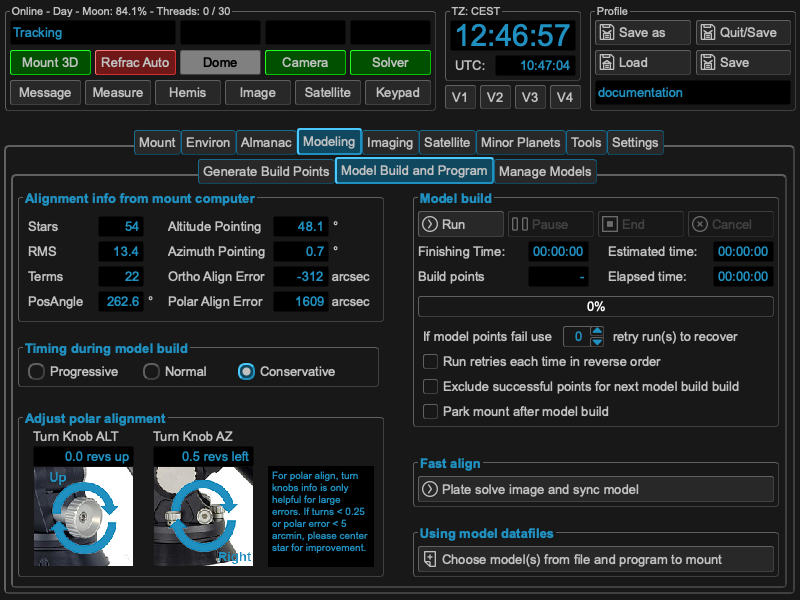

Step 3: Running the model build
===============================
After you have selected you build points, MountWizzard4 could automatically run
through the points, take images and plate solve them. When the run finishes,
MountWizzard4 uses the collected data to program the model.

The "model build and program" tab shows the current model information. Use it
to review your results and identify whether your mechanical setup needs
adjustment before building a model for imaging.

.. warning::    Any changes in your mechanical setup invalidates the model!

Modeling automatics
^^^^^^^^^^^^^^^^^^^
The automation process is explained by the next drawing. It is quite simple, but
there are some important topic, which you should care about.

.. image:: image/model_process.drawio.svg
    :align: center

MountWizzard4 tries to do as much steps at the same time as possible to reach
the minimum model build time. So **"Take an image"** means that the signal to
do the next slew to the point is already started when the camera sends image
integration finished. During image download and image saving, slewing is already
on the way. The same happens to image solve. MountWizzard4 does not wait until
an image is plate solved, but manages as much images in the shortest time. If
your plate solver is fast, your don't see much of this asynchronous behavior, if
you use a slower one or if you are running MountWizzard4 on a slower machine,
you might experience a stack of plate solving tasks when the mount slewing and
imaging is already finished.

.. note::   For the plate solver a starting Ra/Dec and scale hint is necessary
            for a successful plate solve. Please check your environment if INDI
            or INDIGO embeds this data in the FITS header of the image file.

You could **"Pause"** the model build at any time, but MountWizzard4 will finish
after a sequence which allows safely to pause. It will not happen immediately.

You also could **"End"** the model build process at any time. In this case
MountWizzard4 will take all already existing data and tries to program a model
to the mount.

In addition you could **"Cancel"** a model build run. In this case all data is
lost.

MountWizzard4 offers a disabling of dual tracking during the model build run and
restores this state afterwards or a mount park after a model build is finished.

During a model build it might happen due to clouds or other events, that some
of the images from model point could not be solved an therefore used for model
build. For this situation you could enable a retry mechanism for the
**"missed"** points. After running through all points, MountWizzard4 will retry
the missed ones N times and will add their data if possible afterwards.

Using model datafiles
^^^^^^^^^^^^^^^^^^^^^
MountWizzard4 stores for each model build run all data (and some more for
analyse) to build a mount model. With this data you could rebuild at any time
you mount model from scratch if you for example deleted to much points during
optimisation or other reasons.

You can also combine data from multiple model runs into a single model.
Keep the combined selection within the model-building point limit.

The warning about the invalidation of the model when mechanical changes are made
are true for this step as well. Combining model data from different mechanical
setups lead into an invalid model. Rebuilding a model from old data when
mechanical changes were made result also in an incorrect model.

Local analysis of saved models
^^^^^^^^^^^^^^^^^^^^^^^^^^^^^^
Load a saved model file in the analysis window to review its recorded results
and charts. You can compare the points on the two pier sides and inspect their
distribution and pointing errors.

Opening a file does not require a mount connection and does not change the
saved file or the active model. Related charts have linked views, so panning
one chart also updates its linked charts.

Fast Align
^^^^^^^^^^
There is a way to adjust an existing model to a certain sphere position. If you
choose fast align, MountWizzard4 will do for the actual position an image, plate
solve it an align the model to the solved coordinates. This means the whole
model is move in a way, that the actual pointing coordinates and solved
coordinates are equal. But this changes model pointing for all other position in
the sky as well without knowing if this shift really fits there.

.. note::   Fast align is a step to adjust quickly a reasonable model to an
            actual pointing position. This action is not a model build process!
            You most probably loose the pointing accuracy of you model!
